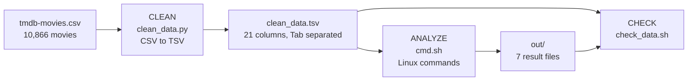

# Linux CMD Project: Analyzing 10,866 Movies with the Command Line

A small data project built with **Linux commands only** (`awk`, `sort`, `cut`, `tr`, `uniq`, `grep`, `bc`).
I take a messy real-world CSV (TMDB movies), clean it, answer 7 questions about it,
and then **prove the answers are correct**: every number is calculated a second way with a different command,
and both results must match.

I built it to practice the habits I want in data work: look at the data first, write down every
problem and every decision, and show that the final numbers can be trusted.

## What this project shows

- **Data cleaning**: finding why a CSV breaks command-line tools (commas and line breaks inside cells) and fixing it.
- **Command-line data processing**: sorting, filtering, aggregating and counting with pipes.
- **Validation**: a check script with PASS / FAIL lines, where each result is verified by an independent method.
- **Honest documentation**: data problems, trade-offs and limitations are written down, not hidden.
- **Repeatable work**: two commands rebuild everything from the raw file.

## Result

| | Count |
|---|---|
| Lines in the CSV file | 10,879 |
| Movies (lines that start with an id) | 10,866 |
| Movies in `clean_data.tsv` | 10,866 (every line has exactly 21 columns) |
| Duplicate movie rows (id 42194, *TEKKEN*) | 1, kept on purpose (see [Known limitations](#known-limitations)) |
| Movies with `budget = 0` / `revenue = 0` | 5,696 / 6,016 (missing data, not real zeros) |
| Movies without a genre | 23 |

Answers to the 7 requirements (all checked by `check_data.sh`):

| # | Question | Answer | File |
|---|---|---|---|
| 1 | Sort by release date, newest first | All 10,866 movies; newest is *Martyrs* (12/31/15) | `out/1_sorted_by_release_date_desc.tsv` |
| 2 | Movies with `vote_average > 7.5` | **350 movies** | `out/2_vote_gt_7.5.tsv` |
| 3 | Highest and lowest revenue | Highest: *Avatar*, 2,781,505,847 USD. Lowest (ignoring revenue = 0): 2 USD, *Shattered Glass* and *Mallrats* | `out/3_revenue.txt` |
| 4 | Total revenue | **432,720,192,875 USD** (about 432.7 billion) | `out/4_total_revenue.txt` |
| 5 | Top 10 movies by profit (revenue - budget) | 1st: *Avatar*, 2,544,505,847 USD | `out/5_top10_profit.txt` |
| 6 | Director and actor with the most movies | Woody Allen (46), Robert De Niro (72) | `out/6_director_actor.txt` |
| 7 | Number of movies per genre | Drama 4,761, Comedy 3,793, Thriller 2,908, ... | `out/7_genres.txt` |

Output of `bash check_data.sh` (second half):

```
=== Part 3: results (each one calculated a second way) ===
  PASS  req 1: sorted file has all movies  (10866)
  PASS  req 1: places where the date goes up  (0)
  PASS  req 2: movies with vote_average > 7.5  (350)
  PASS  req 3: highest revenue  (2781505847)
  PASS  req 4: total revenue  (432720192875)
  PASS  req 5: biggest profit  (2544505847)
  PASS  req 6: director 'Woody Allen'  (46)
  PASS  req 6: actor 'Robert De Niro'  (72)
  PASS  req 7: sum of the genre counts  (26960)
```

## Quick start

```bash
bash cmd.sh          # inspect, clean, and create the 7 result files in out/
bash check_data.sh   # check the data and prove the results
```

Run both commands from the project folder. Needs Python 3 (only for the cleaning step) and the usual
Linux tools (`awk`, `sort`, `bc`, ...). `cmd.sh` also downloads `tmdb-movies.csv` the first time
(the `curl` line at the top; the data comes from a public copy of the TMDB movies dataset).

## Pipeline



| Step | Script | Input | Output |
|---|---|---|---|
| 0. Inspect | first part of `cmd.sh` | `tmdb-movies.csv` | screen: column names, why the CSV cannot be used directly |
| 1. **Clean** | `clean_data.py` | `tmdb-movies.csv` | `clean_data.tsv` |
| 2. **Analyze** | `cmd.sh` | `clean_data.tsv` | `out/1_...` to `out/7_...` |
| 3. **Check** | `check_data.sh` | CSV + TSV + `out/` | screen: counts and PASS / FAIL lines |

The raw file and the clean file are kept separate. If a cleaning rule changes, only
`clean_data.py` runs again, and the original CSV is never changed.

```
├── tmdb-movies.csv      raw data (input)
├── clean_data.py        step 1: CSV to TSV
├── clean_data.tsv       clean data (created by step 1)
├── cmd.sh               steps 0 and 2: inspect the data and answer the 7 requirements
├── check_data.sh        step 3: check the data and prove the results
├── out/                 the 7 result files
└── README.md
```

`cmd.sh` explains every step in comments with the same layout: **WHAT** the command does,
**WHY** it is needed, and **CHECK** how I know the result is right. Most long commands are first
tried on 3 movies, so each part can be seen working before the full command runs.

## Data problems and what I did

| Problem | How I found it | What I did |
|---|---|---|
| Commas inside text cells | `awk -F, '{print NF}'` gives 10, 11, 12... columns, not one number | Read the CSV with Python's `csv` module and write a TSV |
| Line breaks inside cells | 10,879 lines but only 10,866 lines start with an id | Remove line breaks and tabs inside cells in `clean_data.py` |
| `release_date` has a 2-digit year (`12/31/15`) | Cannot tell 1960 from 2060 | Use `release_year` (column 19) for the year |
| `awk` reads `7.5` as `7` on a computer with a decimal comma | Got 1,282 movies instead of 350 | Run `awk` with `LC_ALL=C` |
| Big numbers shown as `4.3272e+11` | First total revenue looked wrong | Print with `printf "%.0f"` |
| `revenue = 0` for 6,016 movies | The "lowest revenue" was 0 for thousands of movies | Treat 0 as missing: ignore it for the lowest revenue, and say so in the answer |
| One duplicate row (*TEKKEN*) | `check_data.sh`: `sort \| uniq -d` on the id column | Kept, see [Known limitations](#known-limitations) |

## How the results are checked

`check_data.sh` has 3 parts and does not change any file:

1. **Input**: lines in the CSV and lines that start with an id.
2. **Clean data**: movies, columns per line, empty ids, duplicates, zeros.
3. **Results**: each answer is calculated again in a different way and compared:

| Requirement | Second way |
|---|---|
| 1. Sorted file | Build the date key again and count the places where it goes up (must be 0) |
| 2. Votes > 7.5 | Count the values in column 18 directly |
| 3. Highest revenue | A running maximum in `awk` instead of `sort` |
| 4. Total revenue | Put `+` between all values and let `bc` add them |
| 5. Biggest profit | Sort ascending and take the last line |
| 6. Director, actor | Count the exact name with `grep -c -x` |
| 7. Genres | The counts must add up to the number of genre names |

## Design decisions

- **Python only for cleaning.** A CSV with quotes, commas and line breaks cannot be read safely with
  `awk` or `cut`. A few lines of Python solve this once, and every analysis step after it uses Linux commands.
- **TSV instead of CSV.** The Tab does not appear inside the cells, so `-F'\t'` and `cut -f` split the columns in the right place.
- **Sort with a `yyyymmdd` key.** Put the key in front of each line, sort by it, then cut it off.
  This sorts dates correctly with `sort`, and the file keeps its original 21 columns.
- **`>` for the header, `>>` for the data.** `>` creates the file with the header, `>>` adds the movies after it.
- **`vote_average > 7.5`, not `>=`.** The task says "greater than", so the 120 movies with exactly 7.5 are out.
- **`revenue = 0` means missing.** A revenue of exactly 0 USD is not believable for a released movie, so I do not call it "the lowest revenue".
- **Split names with `tr '|' '\n'`.** A cell like `Action|Drama` holds more than one value, so every value is put on its own line before it is counted.

## Known limitations

- **One duplicate row.** *TEKKEN* (id 42194) appears twice, so there are 10,865 different movies.
  It adds one extra line to `out/1_...`, 967,000 USD to the total revenue (about 0.0002% of 432.7 billion)
  and one extra movie to five genres. I kept it because the effect is very small and no conclusion changes.
- **Profit uses movies with `budget = 0`.** The top 10 is not affected, because all top 10 movies have a budget.
- **Suspicious value.** *The Net* (1995) shows a profit above 1 billion USD. This is probably an error in the source data.
- **Ties in the sorted file.** Movies with the same release date can be in a different order on a different computer (it depends on the language settings). The order by date is always right.
- **Director count.** 46 for Woody Allen includes movies he co-directed.
- **Cleaning removes line breaks without a space**, so two words at a line break can join. This only touches text columns such as `overview`, which the analysis does not use.

## Next steps

- Remove the duplicate row (`sort -u`) and run requirements 1, 4 and 7 again.
- Use `budget_adj` and `revenue_adj` (adjusted for inflation) to compare old and new movies fairly.
- Add more questions: movies per year, average rating per genre, return on investment (revenue / budget).
